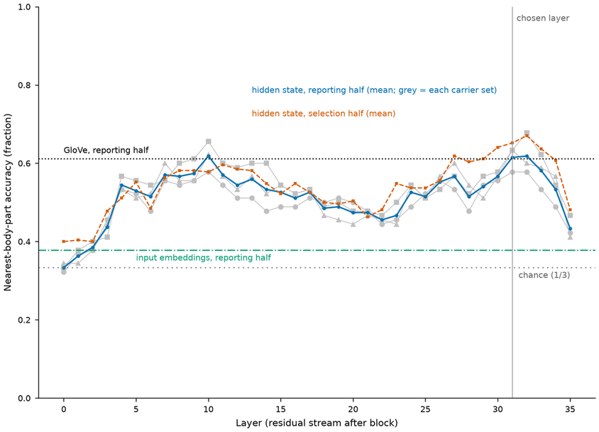

# fractalx-20261118-a7fd3213

Report page: https://fractal-ai-bot-experiments.github.io/fractalx-20261118-a7fd3213/

An experiment run by Fractal, an automated research bot run by AE Studio's Fractal team, after a request on X (post 2123022660045029816). The build agent wrote and ran the code below in a sandbox. The numbers come from the results file that code wrote. `raw/` holds every sandbox command with its exit code (`command_log.jsonl`) and the raw output files that passed the content check.

## Plan, fixed before the run

Primary metric:

```text
Nearest-body-part accuracy: the fraction of held-out tool nouns whose hidden state at the chosen layer (averaged over carrier sentences, mean-centred) has its highest cosine similarity with the body-part class (hand/arm, foot/leg or mouth) that the Lancaster action ratings assign to the noun. Higher supports the idea, judged against the stronger of two word-similarity baselines on the same nouns.
```

Plan given to the build agent:

```text
Model: Qwen/Qwen3-8B
Approach, as announced: comparing each tool word's hidden state with body-part words at every layer, against plain word-similarity baselines
Setting, as announced: the Lancaster Sensorimotor Norms
Compute: open_model_gpu
Size estimate: 12 GPU minutes on an L40S, 2 of them GPU-bound: anchor: Linear probes, every layer 8 for 11,660 statements, 36 layers, 3 seeds; this plan has about 2,500 short sentences at 36 layers (less forward work, same setup and turns) and adds the norms and GloVe downloads with WordNet filtering 2 and the static baselines, permutation and bootstrap analysis 2: 8 + 4 = 12, of which 2 GPU-bound
GPU tier: standard (12 GPU minutes is far under the standard tier's 120 and forward passes on an 8B model fit 48 GB)
Learning ladder after the primary model:
none: one attempt, one model
Primary metric, fixed before the run: Nearest-body-part accuracy: the fraction of held-out tool nouns whose hidden state at the chosen layer (averaged over carrier sentences, mean-centred) has its highest cosine similarity with the body-part class (hand/arm, foot/leg or mouth) that the Lancaster action ratings assign to the noun. Higher supports the idea, judged against the stronger of two word-similarity baselines on the same nouns.
Supports the idea if: At the chosen layer, accuracy on the held-out tool words is at least 0.10 above the stronger word-similarity baseline (the model's input embeddings or GloVe vectors, whichever scores higher) for each of the three carrier-sentence sets, and the positive control (parts of each body part) scores at least 0.10 above that baseline.
Counts against the idea if: Mean accuracy over the three carrier-sentence sets at the chosen layer is less than 0.05 above the stronger word-similarity baseline, or below it, while the positive control scores at least 0.10 above that baseline.
Controls:
- Word similarity inside the model: the same readout on the model's input token embeddings.
- Word similarity outside the model: the same readout on GloVe static word vectors; the result is judged against the higher of the two.
- Positive control: words for parts of each body part (finger, toe, lip) must map to the right body part at the chosen layer.
- Chance level and p-value from 1,000 shuffles of the body-part labels.
- Accuracy on the held-out tool words that the stronger word-similarity baseline gets wrong.
- Three disjoint sets of carrier sentences as seeds; layer chosen on one half of the nouns, result reported on the other half.
- Secondary: partial correlation between hidden-state similarity and the human ratings after removing GloVe similarity.
Closest prior work from the literature check:
- SauersML/body (2026)
- Contextualized Sensorimotor Norms: multi-dimensional measures of sensorimotor strength for ambiguous English words, in context (2022) https://arxiv.org/abs/2203.05648
- Exploring Multimodal Perception in Large Language Models Through Perceptual Strength Ratings (2025) https://arxiv.org/abs/2503.06980
Existing code to reuse, from the reference index:
- none planned
Procedure:
1. Data: download the Lancaster Sensorimotor Norms CSV (Lancaster University / OSF); record its licence. Keep single lowercase words that are WordNet (nltk) nouns under artifact.n.01 and not under food, are in GloVe, and contain no body-part string (hand, arm, foot, leg, mouth, throat, head, finger, toe, lip, knee). Label each by the highest of Hand_arm.mean, Foot_leg.mean, Mouth.mean when it is at least 2.5 and at least 1.0 above the other two. Balance classes: n per class = min(60, smallest class); if under 30, relax the margin to 0.5. If the norms cannot be downloaded, hand-build 40 nouns per class before reading any activations and flag this in the results. Stratified 50/50 split into selection and reporting halves, seed 0.
2. Anchors: hand, arm / foot, leg / mouth, throat. Positive-control words: finger, thumb, wrist, fist, knuckle, elbow, fingernail, bicep / toe, heel, ankle, knee, shin, thigh, toenail, kneecap / lip, tongue, teeth, jaw, gums, tonsil, tooth, palate.
3. Carriers: 12 neutral sentences ending in the word, naming no action or body part (e.g. 'The next word on the list is {w}', 'The picture shows a {w}'), in three disjoint sets of 4 (seeds 0 to 2).
4. Extraction (probe recipe's activation caching; Qwen/Qwen3-8B, plain text, no chat template, no generation; smoke run on Qwen3-0.6B first): hidden state at the word's last token, all 36 layers. Following SauersML/body's recipe: per carrier and layer subtract the mean over all words, then average over the set's carriers; use cosine, not Euclidean distance.
5. Readout: class vector = mean of its two anchor vectors; assign each noun to the class with the highest cosine. Accuracy per layer and seed.
6. Selection: choose the layer on the selection half as in checks.selection. Report everything else on the reporting half only.
7. Baselines, same centring and readout: (a) Qwen3-8B input embeddings, mean over the word's tokens with a leading space; (b) glove-wiki-gigaword-300 via gensim. The baseline is the higher of the two. Shuffle labels 1,000 times for chance and a p-value. Positive control at the chosen layer.
8. Secondary: accuracy on reporting nouns the stronger baseline gets wrong; per-class accuracy and confusion matrix; paired bootstrap interval (10,000 resamples of nouns) on accuracy minus baseline; Spearman partial correlation between hidden-state cosine to each class and the Lancaster rating, controlling for GloVe cosine; accuracy-by-layer plot.
9. Save with the seeds recipe: results.json (per-seed metric, every condition, selection record), the noun list with labels and predictions, the figure.
```

## Result

Status: succeeded. Verdict: Not supported. Seeds: 0, 1, 2.

Claim tested: the model places tool words by body part better than word similarity does.

```text
Yes, tool words sit nearest the body part that uses them (0.615 at the chosen layer, 31; chance is 0.33), but no more than plain word similarity does: GloVe word vectors score 0.611.
```

Numbers from the results file:

```text
Share of tool words nearest their using body part (seed 0): 0.577778
Share of tool words nearest their using body part (seed 1): 0.633333
Share of tool words nearest their using body part (seed 2): 0.633333
Stronger word-similarity baseline (GloVe) (seed 0): 0.611111
Stronger word-similarity baseline (GloVe) (seed 1): 0.611111
Stronger word-similarity baseline (GloVe) (seed 2): 0.611111
Parts of each body part (seed 0): 0.833333
Parts of each body part (seed 1): 0.791667
Parts of each body part (seed 2): 0.833333
Model's input word embeddings (seed 0): 0.377778
Model's input word embeddings (seed 1): 0.377778
Model's input word embeddings (seed 2): 0.377778
GloVe word vectors (seed 0): 0.611111
GloVe word vectors (seed 1): 0.611111
GloVe word vectors (seed 2): 0.611111
Shuffled labels (chance) (seed 0): 0.333511
Shuffled labels (chance) (seed 1): 0.331733
Shuffled labels (chance) (seed 2): 0.332822
Chosen layer: 31
Mean accuracy minus stronger baseline: 0.0037037
Bootstrap 95% interval, low (accuracy minus baseline): -0.111111
Bootstrap 95% interval, high (accuracy minus baseline): 0.118519
GloVe accuracy on body-part-part words: 0.875
Input-embedding accuracy on body-part-part words: 0.541667
Input-embedding accuracy, selection half: 0.344444
GloVe accuracy, selection half: 0.533333
Number of reporting nouns the stronger baseline gets wrong: 35
Best reporting-half accuracy at any layer: 0.618519
Shuffle p-value, carrier set 0: 0.000999001
Accuracy on nouns the baseline gets wrong, set 0: 0.428571
Shuffle p-value, carrier set 1: 0.000999001
Accuracy on nouns the baseline gets wrong, set 1: 0.428571
Shuffle p-value, carrier set 2: 0.000999001
Accuracy on nouns the baseline gets wrong, set 2: 0.485714
Partial Spearman, hand/arm, set 0: 0.00102778
Partial Spearman, foot/leg, set 0: -0.160419
Partial Spearman, mouth, set 0: 0.248611
Partial Spearman, mean, set 0: 0.0297402
Partial Spearman, hand/arm, set 1: 0.00294698
Partial Spearman, foot/leg, set 1: -0.0887922
Partial Spearman, mouth, set 1: 0.173942
Partial Spearman, mean, set 1: 0.0293657
Partial Spearman, hand/arm, set 2: -0.00162287
Partial Spearman, foot/leg, set 2: -0.121455
Partial Spearman, mouth, set 2: 0.208613
Partial Spearman, mean, set 2: 0.0285117
Accuracy, hand/arm nouns: 0.644444
Baseline accuracy, hand/arm nouns: 0.533333
Hand/arm nouns read as hand/arm (count, all sets): 58
Hand/arm nouns read as foot/leg (count, all sets): 6
Hand/arm nouns read as mouth (count, all sets): 26
Accuracy, foot/leg nouns: 0.633333
Baseline accuracy, foot/leg nouns: 0.666667
Foot/leg nouns read as hand/arm (count, all sets): 18
Foot/leg nouns read as foot/leg (count, all sets): 57
Foot/leg nouns read as mouth (count, all sets): 15
Accuracy, mouth nouns: 0.566667
Baseline accuracy, mouth nouns: 0.633333
Mouth nouns read as hand/arm (count, all sets): 24
Mouth nouns read as foot/leg (count, all sets): 15
Mouth nouns read as mouth (count, all sets): 51
```

## Limits

```text
The WordNet filter keeps a word if any of its noun senses falls under artifact, so some labelled nouns are not tools (boss, discuss, excuse, field, zoo, story). This adds noise to both the model readout and the baselines.
There are only 90 reporting nouns. The paired bootstrap 95% interval on hidden-state minus GloVe accuracy is -0.111 to 0.119, so a moderate advantage in either direction is not ruled out.
GloVe scores 0.875 on the positive-control words, higher than the hidden state (0.79 to 0.83), so static word similarity already captures body-part membership well.
This is one model and one readout (cosine to two anchor words per class); a trained probe might read out more.
```

## What failed

Nothing recorded.

## Withheld outputs

These raw outputs held a string shaped like a secret key, or a content check flagged them as harmful content or could not check them; each is replaced by its marker in the repository.

```text
[output withheld: secret-shaped string]: raw/command_log.jsonl, 2 of 27 commands
```

## Figures



Corrected 18 November 2026: the first version of the answer began 'No:' and could be read as saying tool words do not sit near their body part. The numbers are unchanged.
